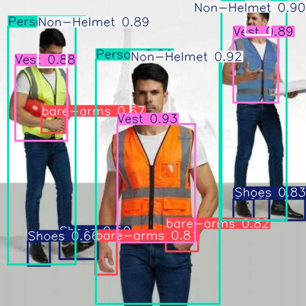
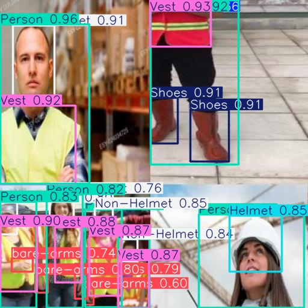
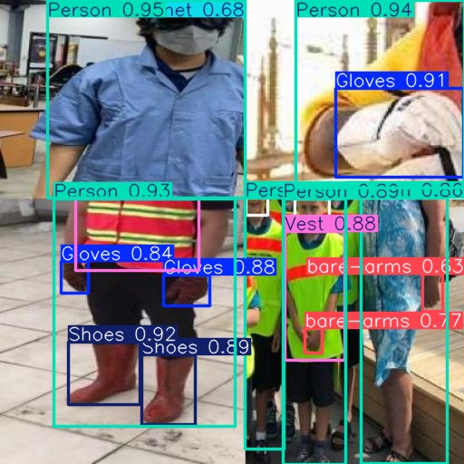
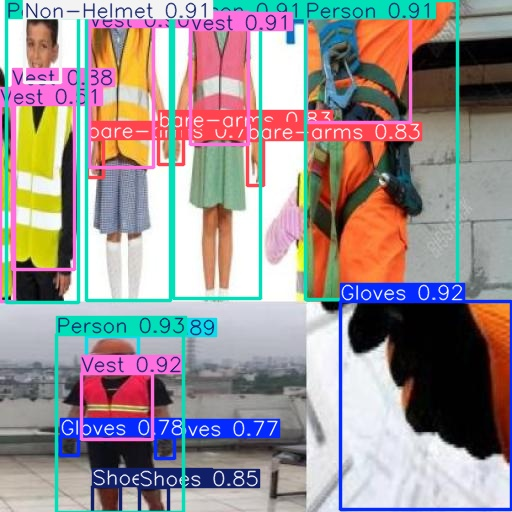
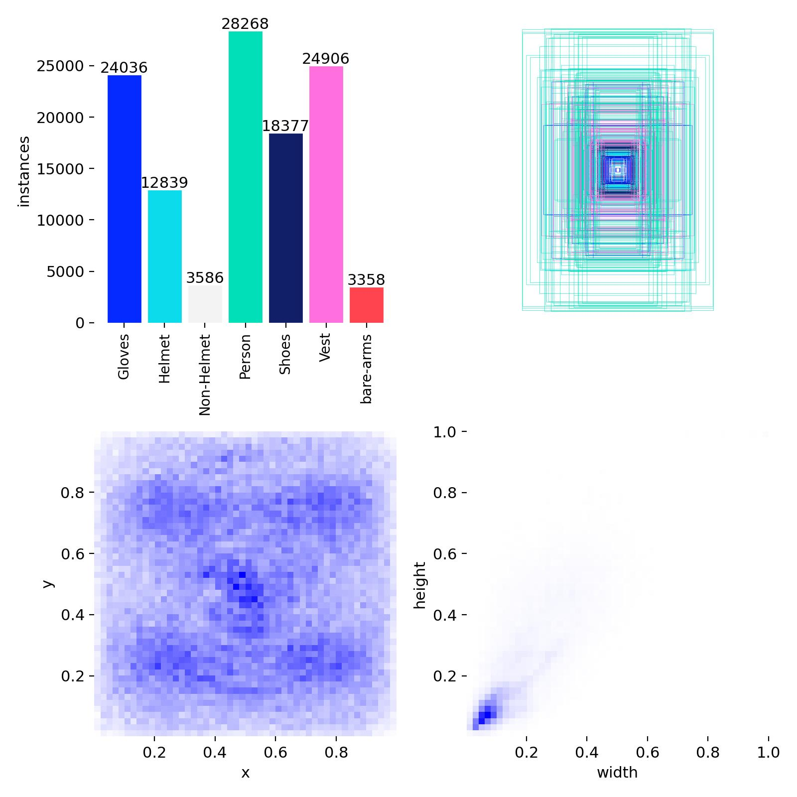
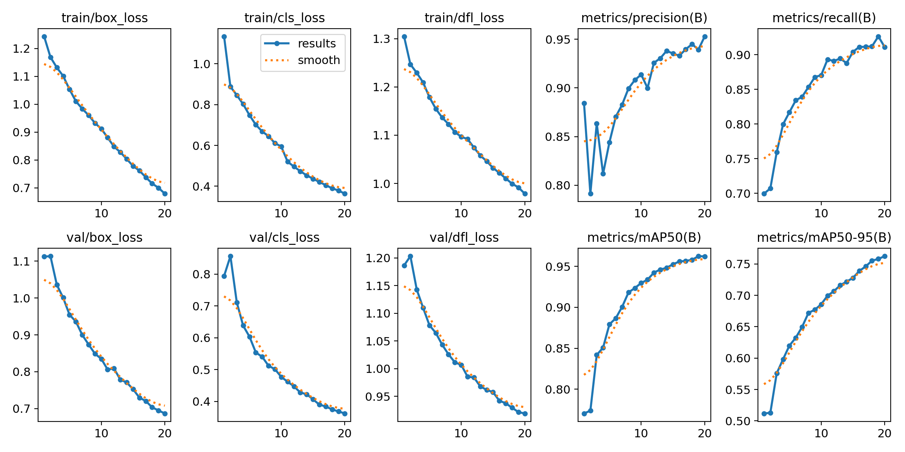
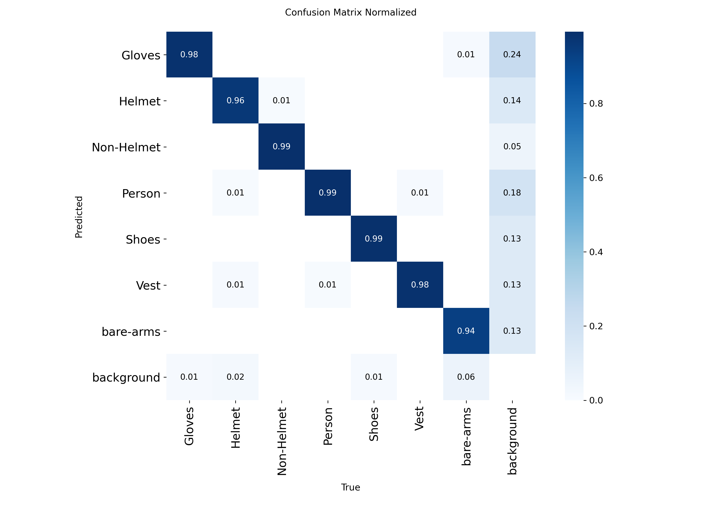
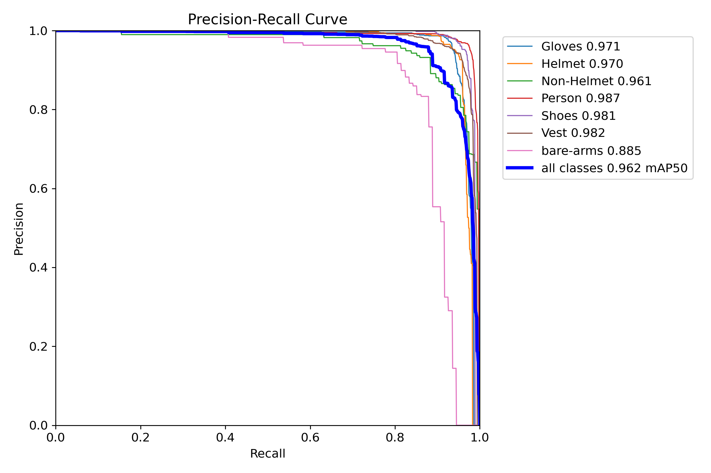
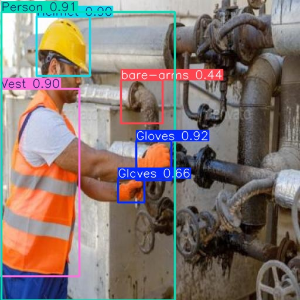
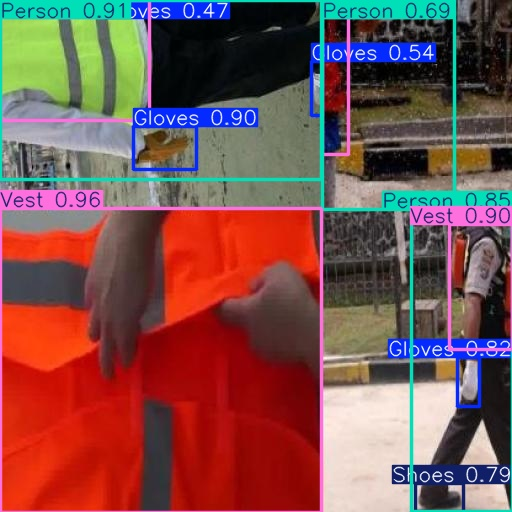

# PPE Detection: Does Model Size Matter? YOLO11n vs YOLO11s

A focused experiment on detecting personal protective equipment (PPE) on construction sites, comparing two sizes of YOLO11 trained on the same data, with a per-class look at where each model succeeds and fails.

<p align="center">
  
  
</p>
<p align="center">
  
  
</p>

## Why this project

During my MBKM internship in the PPHSE (health, safety and environment) division at PT Krakatau Tirta Industri, I saw how much of safety inspection relies on people visually checking whether workers wear the right equipment. This project explores how well an off-the-shelf detector can handle that task, and what limits it.

## What it detects

| Class | Meaning |
|---|---|
| `Person` | A worker |
| `Helmet` | Hard hat being worn |
| `Non-Helmet` | Head without a hard hat |
| `Vest` | High-visibility safety vest |
| `Gloves` | Work gloves |
| `Shoes` | Safety shoes |
| `bare-arms` | Exposed arms |

## Dataset

- **Source:** [Site Construction Safety](https://universe.roboflow.com/site-construction-safety/site-construction-safety) on Roboflow Universe
- **License:** CC BY 4.0
- **Size:** 3,858 images in total

| Split | Images | Notes |
|---|---|---|
| Train | 9,861 | 3,287 originals, tripled by Roboflow's built-in augmentation in this dataset version |
| Validation | 340 | Used during training to pick the best checkpoint |
| Test | 231 | Held out, used only once for the final scores |

Class balance is uneven: the test set has 626 `Person` boxes but only 71 `Non-Helmet` and 69 `bare-arms` boxes.

<p align="center"></p>

## Training setup

| Setting | Value |
|---|---|
| Framework | Ultralytics 8.4.218, PyTorch |
| Hardware | Google Colab, NVIDIA Tesla T4 |
| Starting weights | COCO-pretrained YOLO11n / YOLO11s (transfer learning) |
| Image size | 640 |
| Batch size | 16 |
| Optimizer | AdamW (selected automatically by Ultralytics) |
| Epochs | YOLO11n: 40. YOLO11s: 20 |
| Checkpoint used | `best.pt` (highest validation mAP50-95) |

## Results (test set, 231 images)

| Model | Params | Epochs | mAP50 | mAP50-95 | Precision | Recall | Inference / image |
|---|---|---|---|---|---|---|---|
| YOLO11n | 2.6M | 40 | 0.955 | 0.747 | 0.955 | 0.907 | 5.4 ms |
| **YOLO11s** | 9.4M | 20 | **0.963** | **0.774** | 0.958 | 0.910 | 9.2 ms |

Inference time measured on a Tesla T4 during evaluation, excluding pre and post-processing.

### Per class (mAP50-95, test set)

| Class | YOLO11n | YOLO11s | Gain |
|---|---|---|---|
| bare-arms | 0.569 | 0.638 | **+6.9** |
| Non-Helmet | 0.750 | 0.796 | **+4.6** |
| Gloves | 0.698 | 0.727 | +2.9 |
| Helmet | 0.753 | 0.769 | +1.6 |
| Shoes | 0.746 | 0.759 | +1.3 |
| Vest | 0.863 | 0.872 | +0.9 |
| Person | 0.851 | 0.855 | +0.4 |

### Same number of epochs (validation set)

Because the two runs trained for different lengths, I also compared them at the same point in training:

| Model | Epochs | Val mAP50-95 |
|---|---|---|
| YOLO11n | 20 | 0.687 |
| YOLO11s | 20 | 0.763 |
| YOLO11n | 40 | 0.740 |

<p align="center">
  <br>
  <em>YOLO11s training curves</em>
</p>

<p align="center">
  <br>
  <em>YOLO11s normalized confusion matrix (validation set)</em>
</p>

<p align="center">
  <br>
  <em>YOLO11s precision-recall curve per class</em>
</p>

## Findings

1. **Both models generalize.** Test scores closely match validation scores (YOLO11n: 0.747 test vs 0.740 validation mAP50-95), so the models are not just fitting the images used to select checkpoints.
2. **The larger model helps most where the task is hardest.** YOLO11s gained the most on the rarest, most ambiguous classes (`bare-arms` +6.9, `Non-Helmet` +4.6) and almost nothing on large, clear classes like `Person` and `Vest`.
3. **Capacity mattered more than training time.** At 20 epochs, YOLO11s led by +7.5 validation mAP50-95, and YOLO11n never reached that score even after twice the training (40 epochs). YOLO11n was still improving slowly at the end, but by less than 0.01 over its last 5 epochs.
4. **Errors are about finding objects, not telling them apart.** The confusion matrix shows classes are almost never mixed up with each other (0.94 to 0.99 on the diagonal). Nearly all errors are object vs background: the most common false alarm is `Gloves` (24% of all false positives), and `bare-arms` is the class most often missed entirely.
5. **`bare-arms` is limited by data, not model size.** In both models, `bare-arms` precision is high (0.91 to 0.96) but recall is low (0.73 to 0.77): when the model flags bare arms it is usually right, but it misses about 1 in 4. The larger model improved box quality but not recall. With only 69 test instances and an ambiguous labeling boundary, more and more consistent training examples are the likely fix.
6. **For safety, missed detections are the costly error.** A missed violation is worse than a false alarm, so in deployment I would lower the confidence threshold for `bare-arms` and `Non-Helmet` and accept more false positives.

### Speed vs accuracy

YOLO11s gives +2.7 mAP50-95 at about 1.7x the inference time. Both are real-time on a T4. On a server handling many cameras, YOLO11s is the better choice; on a low-power edge device, YOLO11n keeps most of the accuracy at a fraction of the compute.

## Where it fails

<p align="center">
  
  
</p>

Left: ground truth labels (green). Right: model predictions.

- `fail_1.jpg`: TODO, describe what the model missed or got wrong
- `fail_2.jpg`: TODO, describe what the model missed or got wrong

## Limitations

- Uses a public dataset; images are not from Indonesian worksites, so performance on local sites is untested.
- Many test images are collages of 4 photos stitched into one (likely an augmentation step by the dataset author), so test scores may not fully reflect performance on single, natural camera frames.
- Some images are stock or studio photos rather than real worksites.
- `Non-Helmet` and `bare-arms` have fewer than 75 test instances each, so their scores are less reliable than other classes.
- Single run per model with a fixed seed; no repeated runs to measure variance.
- The model detects equipment; it does not yet decide whether each individual worker is compliant.

## How to run

```bash
pip install ultralytics
```

```python
from ultralytics import YOLO

model = YOLO("weights/best_yolo11s.pt")
model.predict("your_image.jpg", conf=0.4, save=True)
```

Training and evaluation steps are in [`train.ipynb`](train.ipynb).

## Repository structure

```
├── README.md
├── train.ipynb
├── weights/
│   ├── best_yolo11n.pt
│   └── best_yolo11s.pt
└── assets/
    ├── demo_1.jpg ... demo_4.jpg
    ├── fail_1.jpg, fail_2.jpg
    ├── labels.jpg
    ├── results_s.png
    ├── confusion_matrix_s.png
    └── pr_curve_s.png
```

## Next steps

- **Per-worker compliance check:** match each `Person` box with overlapping `Helmet` and `Vest` boxes and label the worker as compliant, missing helmet, or missing vest.
- Test on photos from Indonesian worksites to measure how well the model transfers.
- Collect more `bare-arms` and `Non-Helmet` examples and tune per-class confidence thresholds.

## Acknowledgements

- Dataset: Site Construction Safety, Roboflow Universe, licensed under CC BY 4.0
- Models: [Ultralytics YOLO11](https://docs.ultralytics.com/)
